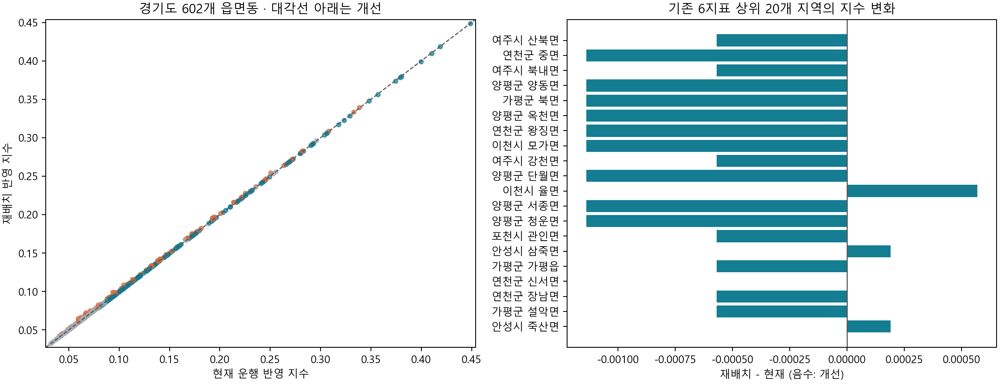

# DRT를 반영한 경기도 이동격차지수 비교

현재 운행 326대와 제공된 재배치 326대를 경기도 602개 읍면동에 반영한 **가정 기반 비교**다. 기존 6개 취약점수에 DRT 공급부족 점수를 추가했으며, 두 시나리오에 같은 정규화 기준과 같은 엔트로피 가중치를 사용했다. 지수가 클수록 취약하다.

## 결과

- 개선 236개, 악화 102개, 동일 264개.
- 전체 평균: 현재 0.109970721, 재배치 0.109970721.
- 기존 6지표 상위 20개 지역 평균 변화: -0.000662953 (재배치 − 현재).
- DRT 공통 가중치: 0.568245744%. 가중치는 정책적 중요도나 실제 개선효과의 비율이 아니다.
- 두 시나리오 순위상관(Spearman): 0.999725421, 각각 상위 20개 중 공통 지역 20개. 순위가 바뀐 지역은 391개다. 지수가 개선되어도 다른 지역과의 상대순위는 악화될 수 있다.

| 대상 | 시나리오 | 읍면동수 | 대수합계 | 공급양수_읍면동수 | 지수평균 | 지수표준편차_ddof0 | 지수최대 | 지수최소 | 기존지표결측_읍면동수 |
| --- | --- | --- | --- | --- | --- | --- | --- | --- | --- |
| 경기도 전체 | 현재 | 602 | 326.000000 | 113 | 0.109971 | 0.072577 | 0.448959 | 0.032137 | 32 |
| 경기도 전체 | 재배치 | 602 | 326.000000 | 313 | 0.109971 | 0.072437 | 0.448390 | 0.032137 | 32 |
| 기존6지표 상위20 | 현재 | 20 | 9.666667 | 7 | 0.348733 | 0.044480 | 0.448959 | 0.292746 | 0 |
| 기존6지표 상위20 | 재배치 | 20 | 33.000000 | 20 | 0.348070 | 0.044302 | 0.448390 | 0.292178 | 0 |
| 기존6지표 상위50 | 현재 | 50 | 31.000000 | 18 | 0.297420 | 0.052531 | 0.448959 | 0.231137 | 0 |
| 기존6지표 상위50 | 재배치 | 50 | 63.000000 | 50 | 0.297057 | 0.052252 | 0.448390 | 0.230569 | 0 |
| 기존지표 결측없음 | 현재 | 570 | 286.000000 | 98 | 0.110704 | 0.073824 | 0.448959 | 0.032137 | 0 |
| 기존지표 결측없음 | 재배치 | 570 | 308.000000 | 295 | 0.110683 | 0.073694 | 0.448390 | 0.032137 | 0 |

**총량 326대를 보존하고 DRT 대수를 선형 변환하므로 전체 평균이 같은 것은 산식상 필연이다.** 전체 평균 감소를 재배치의 성공 기준으로 사용할 수 없다. 기존 취약지역의 점수 변화, 분산, 공급 지역 수와 악화지역을 함께 읽어야 한다. 차량 대수가 늘면 지수가 내려가도록 정의한 모형이므로 실제 이동시간·대기시간·이용자 편익의 개선을 실증한 결과가 아니다.

## 동일한 기준으로 계산한 방법

1. `inputs/national_baseline.csv`는 최종 노트북을 기존에 재실행하여 저장한 전국 3,555행의 **전처리 결과 스냅샷**이다. 원본 노트북의 엔트로피 함수로 전국 6개 가중치와 기존 지수를 재현 검증했다. 제공 시뮬레이션의 기존 지수도 602행 모두 이 스냅샷과 일치한다.
2. 기존 6개 취약점수는 전국 기준 정규화 상태를 그대로 유지했다. 이번에는 자동차·고령인구 원자료부터 전처리를 다시 실행하지 않았다. 저장소에서 원본 고령인구 XLS가 빠져 있어, 독립 실행 가능한 입력으로 이 스냅샷을 보관했다. 원본 노트북과 과거 입력 해시 기록도 포함했다.
3. 현재 운행 CSV 61개 권역의 326대를 행정동에 연결했다. 권역별 대상 동이 n개면 각 동에 `권역대수/n`을 가상 귀속한다. 여러 권역이 같은 동에 연결되면 합산하며, 같은 권역 내 중복 동은 허용하지 않는다. 소수 대수는 실제 주차·배차 대수가 아닌 공유 차량의 분석상 지분이다.
4. 재배치 CSV의 `재배치_대수`를 그대로 사용했다. CSV의 `이동격차지수`나 `현재_귀속대수`를 7번째 지표로 사용하지 않았다. 제공된 재배치안의 최적성이나 차량 운영 가능성을 새로 검증한 것은 아니다.
5. 공통 DRT 점수: `1 − (대수 − 0) / (10 − 0)`. 최소·최대는 현재/재배치 두 분포를 합쳐 정했다. 제공 자료에서 연결되지 않은 동은 이 분석에서만 0대로 처리하며, 실제 DRT 미운행을 확정하지 않는다.
6. 두 시나리오 1,204행을 합쳐 원본과 동일한 엔트로피 알고리즘을 적용했다. 결측 없는 1140행에 `X'=X×(1−2ε)+ε`, `ε=10⁻⁶`, `P=X'/열합`, `E=−Σ(P ln P)/ln(n)`, `w=(1−E)/Σ(1−E)`를 적용했다. 최종 지수는 `Σ(w×취약점수)`다.
7. 경기도 밖의 DRT 자료가 없으므로 다른 지역을 임의로 0대로 두지 않고 **가중치는 경기도 비교용으로 새로 적합**했다. 따라서 원본 전국 6지표 가중치와 다르다. 서울 제외 여부는 이번 경기도 표본에는 해당하지 않는다.

| 지표 | 엔트로피 | 정보효용 | 가중치 |
| --- | --- | --- | --- |
| 지형장벽_취약점수 | 0.974112 | 0.025888 | 0.135261 |
| 자가용미보유_취약점수 | 0.999929 | 0.000071 | 0.000370 |
| 의료_취약점수 | 0.937464 | 0.062536 | 0.326744 |
| 버스정류장_취약점수 | 0.999618 | 0.000382 | 0.001994 |
| 배차간격_취약점수 | 0.911069 | 0.088931 | 0.464651 |
| 고령인구비율_취약점수 | 0.987503 | 0.012497 | 0.065297 |
| DRT공급부족_취약점수 | 0.998912 | 0.001088 | 0.005682 |

두 시나리오에서 가중치를 따로 적합한 값도 `outputs/가중치_별도적합_참고.csv`에 제공하지만 주 비교에는 사용하지 않았다. 별도 적합 시 점수 변화에 가중치 변화가 섞이기 때문이다. 원본과 같은 동일가중치 1/7 결과도 전체 비교표에 실었다.

## 원본 현재 귀속대수 300대와의 차이

제공 시뮬레이션의 `현재_귀속대수` 합은 300대다. 새 운행 CSV의 326대를 전부 반영하기 위해 권역 연결을 다시 구성했다. 28개 동의 귀속이 달라지며, 차이 합계는 26대다. 이는 단순히 26대를 추가한 것만이 아니라 기존 귀속 위치와 공동권역 배분도 수정한 결과다. `outputs/현재귀속_300대와326대_차이.csv`에 전부 기록했다.

주요 사례: 연천읍·내산리는 기존 내산리→신서면 규칙을 반영해 1대씩, 의왕 초평동은 기존 규칙에 따라 부곡동에 연결한다. 향동동은 화전동, 스마트허브는 초지동에 연결한다. 운정·고덕·동탄·양주·민락 등은 기존 후보 정책을 유지하며 후보 대상에 균등 배분하는 분석 가정을 쓴다. 권역의 연결상태와 차량 배분 가정은 서로 다른 정보다.

## 연결 불확실성과 결측

- 후보 권역은 15개, 해당 권역 차량은 123대다. 후보를 포함하여 전체 326대를 비교하므로 이 결과는 확정적인 행정동별 운행현황이 아니다. 정확한 서비스 경계·운영시간·좌석수·승객 수를 적용하지 않았다.
- `inputs/route_mapping.json`에 61개 권역의 대상 동, 연결 상태, 배분 가정과 근거를 모두 공개했다. 이천 시내권을 4개 행정동에 나누는 것, 감일·위례 지구 연결 등은 잠정 가정이다. 행정동 연결이 그 동 전역 운행을 뜻하지 않는다.
- 기존 6지표에 결측이 있는 동은 32개다. 원본을 재현하기 위해 가중치 적합에서는 해당 행을 제외하고, 지수 합산에서는 결측점수를 0으로 처리했다. 이로 인한 취약성 과소평가 가능성이 있으며 해당 동을 결과표에 표시했다. 결측 없는 지역만의 요약도 별도 제공한다.
- 기존 버스 지역 평균 대체 및 자동차등록대수 대리지표의 한계는 유지된다. 7번째 지표는 인구·면적당 공급이 아니라 **읍면동에 귀속한 차량 대수**이므로 수요 대비 공급 적정성이나 서비스 수준을 직접 나타내지 않는다.
- 재배치안이 기존 지수에 따라 만들어졌다면 기존 취약지역의 점수가 내려가는 것은 설계상 기대되는 결과다. 독립적인 정책효과 검증과 구분해야 한다.

## 새로 확인한 행정동 연결 참고

광주시 공식 자료의 광남1동 관할 목록 및 광남2동 설명에 따라 태전동은 광남1·2동 후보로, 장지동은 광남1동에 연결했다. 고산동은 광주시 공식 안내 및 도시관리공사 목록을 근거로 오포1동에 연결했다. 서비스 경계는 별도 검증하지 않았다.

- [광주시 광남2동 일반현황](https://tour.gjcity.go.kr/csc/contents.do?mId=1601020000)
- [광주시 예방접종기관의 행정동·법정동 표기](https://www.gjcity.go.kr/depart/img/sub08/2025_child.pdf)
- [광주도시관리공사 공원 목록](https://gumc.or.kr/business/park8)

나머지 기존 관할 변환 근거는 `inputs/original_boundary_rules.json`과 권역별 CSV의 참고URL에 보존했다. 기존 자료의 링크 전체를 이번에 재조회한 것은 아니다.

## 검증 결과

| 전국행수 | 경기도행수 | 현재대수 | 재배치대수 | 입력현재귀속대수 | 권역수 | 권역별차량보존 | 키중복수 | 원본6지표재현 | 공통가중치합계 | 지수변화산식검증 | 평균동일검증 |
| --- | --- | --- | --- | --- | --- | --- | --- | --- | --- | --- | --- |
| 3555 | 602 | 326.000000 | 326.000000 | 300.000000 | 61 | True | 0 | True | 1.000000 | True | True |

## 파일과 재실행

- `outputs/01_현재운행반영_이동격차지수.csv`: 현재 운행을 반영한 602개 지역 지수와 순위.
- `outputs/02_재배치반영_이동격차지수.csv`: 재배치를 반영한 602개 지역 지수와 순위.
- `outputs/03_두시나리오_전체비교.csv`: 두 지수, 차량수, 변화, 순위, 동일가중 결과, 결측·후보 표시.
- `outputs/04_요약.csv`, `outputs/05_시군별비교.csv`: 범위별·시군별 요약.
- `outputs/06_공통엔트로피가중치.csv`: 주 비교의 가중치.
- `outputs/현재운행_권역별_읍면동배분.csv`, `outputs/현재운행_61개권역_검증.csv`: 배분 과정과 차량 보존 검증.
- `outputs/현재귀속_300대와326대_차이.csv`: 시뮬레이션의 현재값과 재구성한 현재값 차이.
- `figures/`: PNG 그림 및 비교 PDF.
- `과정_확인.ipynb`: 입력·매핑·산식·결과를 확인하고 다시 실행할 수 있는 노트북.

이 폴더에서 `python run_comparison.py`를 실행하면 결과와 그림을 다시 생성한다. `requirements.txt`에 실제 실행 환경 버전을 기록했다. 입력 SHA-256은 `inputs/manifest.json`, 실행에 사용한 모든 입력과 코드 해시는 `outputs/실행기록.json`에 있다. 입력 스냅샷을 변경하려면 manifest도 새 입력 기준으로 명시적으로 갱신해야 하며, 매핑 변경은 `route_mapping.json`을 수정하면 된다.
