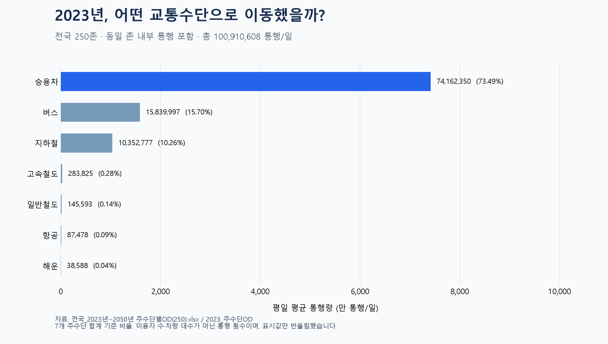

# 두 번째 시각화: 2023년 교통수단별 통행량

## 1. 사용한 데이터
- 원본: `2024-OD-PSN-MOD-10 전국지역간 주수단 OD(250존)(2023-2050)/5. OD/전국_2023년~2050년 주수단별OD(250).xlsx`
- 시트: `2023_주수단OD`. 2025~2050년 장래연도 시트는 사용하지 않았습니다.
- 설명자료: `2024-OD-PSN-MOD-10 전국지역간 주수단 OD(250존)(2023-2050)/2. 설명자료/2024년_전국 교통수요 분석 기초자료 설명자료.hwpx`
- 설명자료 제1절의 평일 O/D 정의와 제2절의 전국 지역간 주수단통행량 표를 확인했습니다. 단위는 엑셀 `대존_2023`에도 통행/일로 표기되어 있습니다.
- 전국 250존(시·군·구 기준의 분석 지역), 250 × 250 = 62,500개 출발지·도착지 조합입니다. 지역 코드는 이름으로 변환하지 않았으며 지역별 지도나 비교는 이번 단계에 포함하지 않습니다.
- 평일(주말·공휴일 제외) 평균 일 통행량입니다. 사람 수나 차량 대수가 아니므로 같은 사람이 여러 번 이동하면 여러 통행입니다.
- 주수단은 전체 이동에서 대표하는 교통수단입니다. 예를 들어 승용차로 역에 접근한 뒤 철도를 이용하는 이동에서 접근 승용차 통행을 별도로 더하지 않습니다.

## 2. 전처리와 집계
1. `extracted` 사본은 읽지 않고 위 원본 파일 하나만 사용했습니다. 원본은 수정하지 않았습니다.
2. 첫 행을 열 이름으로 읽고 A:L의 12개 열만 선택했습니다. 이후 열은 이번 분석에 사용하지 않았습니다.
3. 출발·도착 시도/시군구 코드 4개, 수단별 통행량 7개, 검산용 합계 1개로 구분했습니다.
4. 숫자 형식, 결측값, 음수, 무한대, 중복 OD, 250 × 250 조합을 검사했습니다. 결측값·중복·음수는 모두 0건이며 삭제하거나 임의로 채운 값은 없습니다. 0 통행도 유지했습니다.
5. 동일 존 내부 통행 250개 행도 포함했습니다. 내부 통행 합계는 58,052,262, 다른 존 간 통행 합계는 42,858,346 통행/일입니다. 따라서 그래프는 '서로 다른 지역 사이의 이동만'을 뜻하지 않습니다.
6. A→B와 B→A는 서로 다른 방향의 통행이므로 모두 합산했습니다. 왕복이라는 이유로 2로 나누지 않았습니다.
7. 수단별 열을 각각 합산했습니다. `합계` 열을 여덟 번째 수단으로 더하지 않았습니다. 비율은 해당 수단 합계 ÷ 7개 수단 전체 합계 × 100입니다.
8. 집계 전에는 소수점을 보존하고, 그래프와 표의 표시값만 정수로 반올림했습니다. 작은 수단도 정확한 값과 비율을 읽도록 막대 끝에 수치를 표시했습니다. 가로축은 0부터 시작하는 선형축입니다.

## 3. 결과와 해석
| 교통수단 | 통행/일 (반올림) | 7개 수단 중 비율 |
|---|---:|---:|
| 승용차 | 74,162,350 | 73.49% |
| 버스 | 15,839,997 | 15.70% |
| 지하철 | 10,352,777 | 10.26% |
| 고속철도 | 283,825 | 0.28% |
| 일반철도 | 145,593 | 0.14% |
| 항공 | 87,478 | 0.09% |
| 해운 | 38,588 | 0.04% |

전체 합계는 **100,910,608 통행/일**입니다. 승용차 비율이 가장 높고 버스, 지하철가 뒤를 잇습니다. 이 결과는 내부 통행을 포함한 해당 데이터의 7개 수단 구성비이며, 장거리 이동만의 구성비나 도보·자전거 등을 모두 포함하는 전체 이동의 분담률로 해석하면 안 됩니다. 수단별 규모 차이를 보여주며 그 원인을 설명하는 분석은 아닙니다.

## 4. 검증 및 재실행
- 각 행의 7개 수단 합계와 원본 합계 열의 최대 차이: 2.842170943e-14 통행/일.
- 원본 `대존_2023`의 수단별 총합계와 재집계값의 최대 차이: 2.980232239e-08 통행/일. 부동소수점 오차 범위에서 일치합니다.
- 상세 검사: `validation.json`; 가공 데이터: `od_2023_clean.csv`; 수단별 집계: `mode_summary.csv`.
- 사용 라이브러리: pandas 3.0.5, openpyxl 3.1.5, matplotlib 3.11.2, numpy 2.5.3.
- 작업 폴더에서 실행: `.venv\Scripts\python.exe visualizations/02_od_2023/make_chart.py`

다음 단계에서는 동일 존 내부 통행을 제외한 뒤 이 그래프와 비교할 수 있습니다.

연도 비교 시 참고: 2023년 원본의 수단명은 지하철이며 2024년 원본은 도시철도입니다. 이 분석에서는 원본 명칭을 유지했습니다. 또한 존 수가 250개에서 252개로 달라져 지역별 비교 전 존체계 대응 확인이 필요합니다.

