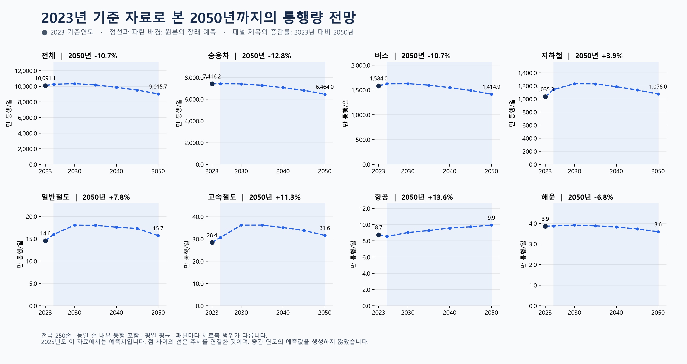

# 2023년 기준 OD의 장래 통행량 전망

## 사용한 데이터와 예측의 의미
- 원본: `2024-OD-PSN-MOD-10 전국지역간 주수단 OD(250존)(2023-2050)/5. OD/전국_2023년~2050년 주수단별OD(250).xlsx`
- 시트: `2023_주수단OD`, `2025_주수단OD`, `2030_주수단OD`, `2035_주수단OD`, `2040_주수단OD`, `2045_주수단OD`, `2050_주수단OD`.
- 2023년 분석과 동일한 배포본의 250존 자료입니다. 2024년 기준 252존 배포본은 섞지 않았습니다.
- 새로 예측모형을 만든 것이 아니라 **배포 파일에 포함된 장래 예측값을 시각화**했습니다. 2023년은 기준연도 OD이며, 단순 원시 관측치로 부르지 않습니다.
- 2025년은 현재 시점에 과거가 되었더라도 이 배포본에서는 예측치입니다. 이후 실측값으로 대체하지 않았습니다.
- 단위: 평일 평균 통행/일. 같은 존 내부 이동도 포함합니다. 이용자 수나 차량 대수가 아닙니다.

## 전처리와 검증
1. 각 시트 첫 행을 열 이름으로 사용하고 A:L의 지역 코드 4개, 수단 7개, 합계 1개를 선택했습니다.
2. 연도마다 250 × 250 = 62,500행을 확인했습니다. 7개 연도 총 437,500행입니다.
3. 숫자 형식, 유한값, 정수 지역 코드, 결측값, 음수, 중복 출발·도착 조합을 검사했습니다. 결측값·음수·중복은 모든 연도에서 0건으로 삭제나 대체는 하지 않았습니다.
4. 연도별 OD 코드 조합이 2023년과 동일한지 검사했습니다. 동일 존 250개 행도 유지하고, 양방향 통행은 각각 합산했습니다.
5. 7개 수단을 각각 합산했습니다. 합계 열을 다시 더하지 않았습니다. 비율은 각 연도의 7개 수단 총합을 분모로 계산했습니다.
6. 행별 수단 합계와 합계 열의 차이는 최대 9.094947018e-13 통행/일입니다. 수단별 집계와 `대존_연도` 요약표의 차이는 최대 2.980232239e-08 통행/일로 부동소수점 오차 범위에서 일치합니다.
7. 계산은 소수점을 유지하고 표시할 때 반올림했습니다. 보간·외삽·신규 모델 학습은 하지 않았습니다. 점선은 제공된 연도 값만 연결합니다.

## 전체 통행량
| 연도 | 구분 | 통행/일 |
|---|---|---:|
| 2023 | 기준연도 | 100,910,608 |
| 2025 | 장래 예측 | 102,566,630 |
| 2030 | 장래 예측 | 103,314,709 |
| 2035 | 장래 예측 | 101,724,931 |
| 2040 | 장래 예측 | 98,628,644 |
| 2045 | 장래 예측 | 95,085,793 |
| 2050 | 장래 예측 | 90,157,273 |

제공된 연도 중 전체 통행량은 2030년에 가장 높고, 2050년은 2023년 대비 -10.66%입니다. 제공되지 않은 연도를 포함한 정확한 정점 연도라고 단정할 수 없습니다.

## 수단별 변화
| 수단 | 2023년 통행/일 | 2050년 통행/일 | 증감률 |
|---|---:|---:|---:|
| 승용차 | 74,162,350 | 64,639,675 | -12.84% |
| 버스 | 15,839,997 | 14,149,139 | -10.67% |
| 지하철 | 10,352,777 | 10,760,392 | +3.94% |
| 일반철도 | 145,593 | 156,951 | +7.80% |
| 고속철도 | 283,825 | 315,768 | +11.25% |
| 항공 | 87,478 | 99,403 | +13.63% |
| 해운 | 38,588 | 35,946 | -6.85% |

각 패널은 수단별 변화를 읽기 위해 서로 다른 세로축 범위를 사용하며, 모두 0에서 시작합니다. 패널 간 선의 높이로 절대량을 비교하지 마세요. 증감률은 (2050년 값 / 2023년 값 − 1) × 100입니다.

이 결과는 해당 배포본의 전망이며 미래에 확정적으로 발생할 수치는 아닙니다. 감소나 증가의 원인을 이 집계만으로 추론하지 않았습니다. 원본에 예측구간이 제공되지 않아 신뢰구간도 표시하지 않았습니다.

## 결과 파일과 재실행
- `forecast_by_mode.csv`: 연도·수단별 통행량, 구성비, 내부/외부 통행량.
- `forecast_totals.csv`: 연도별 수단 합계와 전체 합계.
- `validation.json`: 사용한 원본 경로와 연도별 검증 결과.
- 실행: `.venv/Scripts/python.exe visualizations/03_od_forecast_2023/make_chart.py`

