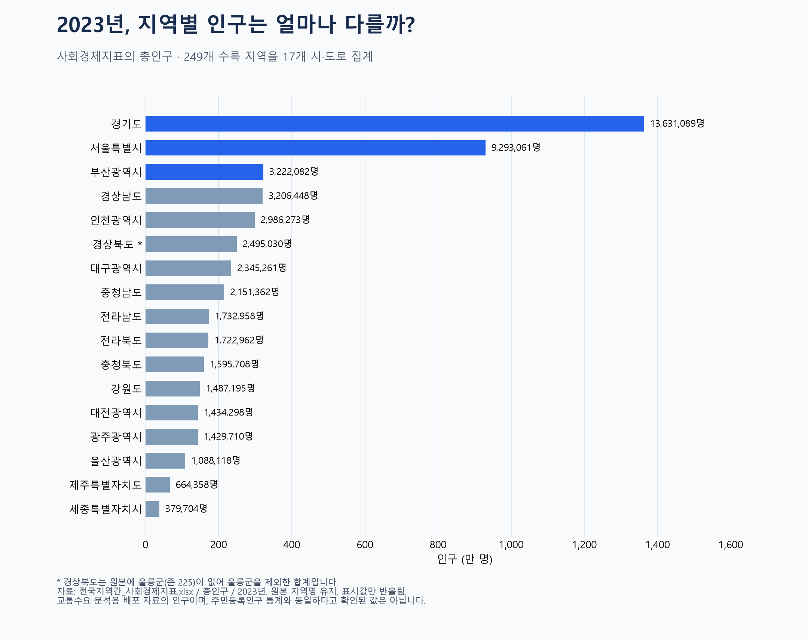

# 2023년 지역별 인구 비교

## 사용 자료
- 원본: `2024-OD-PSN-MOD-10 전국지역간 주수단 OD(250존)(2023-2050)/3. 사회경제지표/전국지역간_사회경제지표.xlsx`
- 사용 시트: `총인구`; 사용 연도: `2023년`. 장래 인구와 다른 연령층 시트는 합산하지 않았습니다.
- 지역 누락 확인용: `2024-OD-PSN-MOD-10 전국지역간 주수단 OD(250존)(2023-2050)/1. 존체계/250 존체계.xlsx`.
- 앞서 분석한 2023년 교통자료와 같은 배포 묶음의 사회경제지표입니다. 이번 그래프에는 OD 통행량을 사용하지 않았습니다.
- 원본 인구에 소수점이 포함되어 있습니다. 교통수요 분석용 배포 자료의 수치로 읽어야 하며, 주민등록인구 원자료와 동일하다고 확인된 값은 아닙니다. 소수점의 발생 원인이나 외국인 포함 여부는 이번 확인 범위에서 확정하지 않았습니다.

## 전처리
1. A:D의 시도, 시군구, 존코드, 2023년 인구만 읽었습니다. 원본 `시도코드` 열에는 숫자가 아닌 시도명이 들어 있어 `시도`로 이름을 바꿨습니다.
2. 지역명 앞뒤 공백을 정리하고 숫자 열을 확인했습니다. 강원도·전라북도 등 인구 원본의 지역명을 유지했습니다. 존체계의 `강원특별자치도`는 대조할 때 인구 시트의 `강원도`와 같은 이름으로 맞췄습니다.
3. 기존 249행의 결측 셀, 음수 인구, 중복 존코드는 모두 0건입니다. 소수 인구가 있는 행은 157개입니다.
4. 별도 250존 목록과 대조하니 **존 225, 경상북도 울릉군 행이 빠져 있습니다**. 이는 셀 결측과 다른 문제입니다. 임의로 0명 또는 추정 인구를 넣지 않았습니다. 기존 행의 존코드와 시도 대응도 확인했습니다.
5. 시군구를 나눈 단위가 지역마다 달라 첫 비교는 17개 시도로 통일했습니다. 같은 시도에 속한 수록 지역의 인구를 합산했습니다. 별도 총계 행을 중복 합산하지 않았습니다.
6. 인구가 많은 순서로 정렬했습니다. 소수점을 유지해 계산하고 그래프와 본문 표에서만 정수로 반올림했습니다. CSV에는 계산값을 보존했습니다.
7. 249개 지역 합계와 17개 시도 집계의 합계가 일치하는지 검증했습니다. 총합은 50,865,615.93명으로, **울릉군이 제외된 수록 인구 합계**입니다.

## 결과
| 시도 | 수록 인구 합계(명, 반올림) | 수록 / 예상 지역 수 |
|---|---:|---:|
| 경기도 | 13,631,089 | 42 / 42 |
| 서울특별시 | 9,293,061 | 25 / 25 |
| 부산광역시 | 3,222,082 | 16 / 16 |
| 경상남도 | 3,206,448 | 22 / 22 |
| 인천광역시 | 2,986,273 | 10 / 10 |
| 경상북도 | 2,495,030 | 22 / 23 |
| 대구광역시 | 2,345,261 | 9 / 9 |
| 충청남도 | 2,151,362 | 16 / 16 |
| 전라남도 | 1,732,958 | 22 / 22 |
| 전라북도 | 1,722,962 | 15 / 15 |
| 충청북도 | 1,595,708 | 14 / 14 |
| 강원도 | 1,487,195 | 18 / 18 |
| 대전광역시 | 1,434,298 | 5 / 5 |
| 광주광역시 | 1,429,710 | 5 / 5 |
| 울산광역시 | 1,088,118 | 5 / 5 |
| 제주특별자치도 | 664,358 | 2 / 2 |
| 세종특별자치시 | 379,704 | 1 / 1 |

경기도, 서울특별시, 부산광역시 순으로 수록 인구 규모가 큽니다. 인구의 절대 규모를 비교한 것으로 면적당 인구밀도나 증가율을 뜻하지 않습니다. 경상북도 값은 울릉군 미포함이며 정확한 전국 총인구로 인용하면 안 됩니다.

## 파일과 재실행
- `population_2023_clean.csv`: 수록된 249개 지역의 2023년 인구.
- `population_by_province.csv`: 17개 시도별 합계, 지역 수, 누락 수, 수록 인구 중 비율.
- `missing_regions.csv`: 원본 인구 시트에 없는 지역.
- `validation.json`: 검증 결과와 출처.
- 실행: `.venv/Scripts/python.exe visualizations/04_population_2023/make_chart.py`
