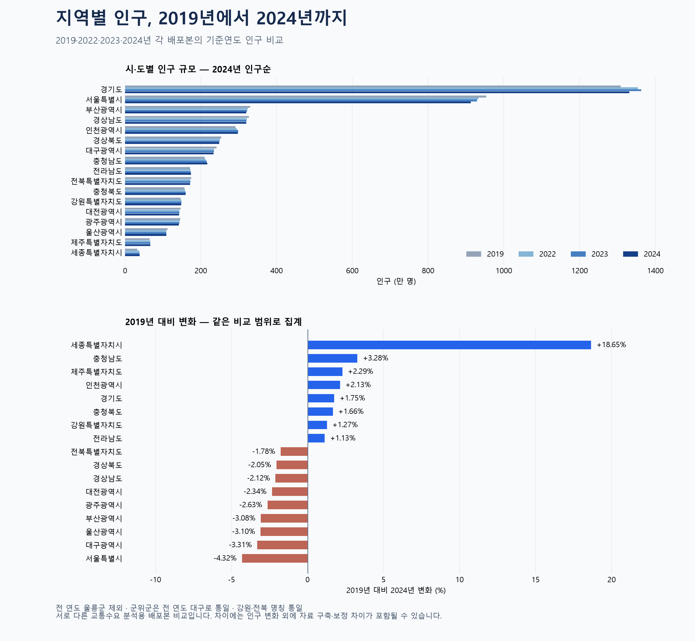

# 2019·2022·2023·2024년 시도별 인구 비교

## 사용한 데이터
- 2019년: `2020-OD-PSN-MOD-10 전국지역간 주수단 OD(250존)(2019-2050)_230608/3. 사회경제지표/전국지역간_사회경제지표.xlsx` / `총인구` / `2019년` 열
- 2022년: `2023-OD-PSN-MOD-10 전국지역간 주수단 OD(250존)(2022-2050)/3. 사회경제지표/전국지역간 장래사회경제지표.xlsx` / `총인구` / `2022년` 열
- 2023년: `2024-OD-PSN-MOD-10 전국지역간 주수단 OD(250존)(2023-2050)/3. 사회경제지표/전국지역간_사회경제지표.xlsx` / `총인구` / `2023년` 열
- 2024년: `2025-OD-PSN-MOD-10 전국지역간 주수단 OD(252존)(2024-2055)/2025-OD-PSN-MOD-10 전국지역간 주수단 OD(252존)(2024-2055)/3. 사회경제지표/전국지역간_사회경제지표.xlsx` / `총인구` / `2024년` 열

각 배포본의 기준연도 자료만 사용했습니다. 장래 예측 열은 사용하지 않았습니다. 2020·2021년은 이 비교에 자료가 없어 보간하거나 채우지 않았습니다. 인구 값에 소수점이 있는 교통수요 분석용 사회경제지표입니다. 주민등록인구 원자료와 같은 시계열이라고 가정하지 않았습니다.

## 지역 범위와 전처리
1. 2019년 `시군구`의 `시도_시군구` 문자열을 분리했습니다. 다른 연도는 시도·시군구 열을 사용했습니다. 존코드는 연도별로 달라지므로 연도 간 동일 지역의 고정 식별자로 사용하지 않았습니다.
2. 숫자 형식, 결측 셀, 중복 지역·존코드, 음수 인구를 확인했습니다. 모두 이상이 없었습니다. 별도 존체계 파일과 대조해 누락 행도 확인했습니다.
3. 울릉군은 2019·2023·2024년에 행이 없고 2022년에는 0명입니다. 이를 실제 인구 0명으로 해석하지 않고 **모든 연도에서 제외**했습니다. 따라서 경북 및 전체 합계는 울릉군 제외 값입니다.
4. 군위군은 2019·2022년 경북에서 2023·2024년 대구로 소속이 달라졌습니다. 경계 변화의 영향을 줄이기 위해 **과거 두 연도도 군위군을 대구에 포함**했습니다. 원본 시도와 변경된 시도를 CSV에 함께 보존했습니다.
5. 강원도→강원특별자치도, 전라북도→전북특별자치도로 명칭을 통일했습니다.
6. 부천시는 2024년에 3개 구로 나뉩니다. 시도별 합산에서 모두 경기도로 묶었습니다. 시군구 범위 대조 때만 이 3개 구를 부천시로 묶고 공백을 제거했습니다. 인천 남구/미추홀구, 세종시/세종특별자치시 명칭도 대조용으로 통일해 네 연도의 지역명 집합이 같은지 검사했습니다. 미세한 행정경계 변화까지 일치한다는 의미는 아닙니다.
7. 시도별로 합산하고 전체 합계 보존을 검증했습니다. 소수점은 유지하고 표시값만 반올림했습니다. 증감률은 `(2024년/2019년−1)×100`입니다.

- 2019년: 원본 249행 → 비교 249행. 군위군 대구 재분류 21,163.62명.
- 2022년: 원본 250행 → 비교 249행. 군위군 대구 재분류 21,452.20명.
- 2023년: 원본 249행 → 비교 249행. 군위군 대구 재분류 0.00명.
- 2024년: 원본 251행 → 비교 251행. 군위군 대구 재분류 0.00명.

## 비교 결과
| 시도 | 2019년(명) | 2022년(명) | 2023년(명) | 2024년(명) | 2019→2024 |
|---|---:|---:|---:|---:|---:|
| 경기도 | 13,085,851 | 13,541,931 | 13,631,089 | 13,315,410 | +1.75% |
| 서울특별시 | 9,535,732 | 9,329,831 | 9,293,061 | 9,124,251 | -4.32% |
| 부산광역시 | 3,300,601 | 3,234,611 | 3,222,082 | 3,199,013 | -3.08% |
| 경상남도 | 3,264,863 | 3,214,274 | 3,206,448 | 3,195,766 | -2.12% |
| 인천광역시 | 2,914,565 | 2,949,407 | 2,986,273 | 2,976,711 | +2.13% |
| 경상북도 | 2,536,749 | 2,510,636 | 2,495,030 | 2,484,856 | -2.05% |
| 대구광역시 | 2,415,392 | 2,353,136 | 2,345,261 | 2,335,366 | -3.31% |
| 충청남도 | 2,098,963 | 2,126,731 | 2,151,362 | 2,167,833 | +3.28% |
| 전라남도 | 1,717,649 | 1,724,385 | 1,732,958 | 1,736,998 | +1.13% |
| 전북특별자치도 | 1,745,478 | 1,723,808 | 1,722,962 | 1,714,488 | -1.78% |
| 충청북도 | 1,570,661 | 1,581,995 | 1,595,708 | 1,596,760 | +1.66% |
| 강원특별자치도 | 1,463,203 | 1,487,647 | 1,487,195 | 1,481,857 | +1.27% |
| 대전광역시 | 1,463,261 | 1,434,044 | 1,434,298 | 1,428,972 | -2.34% |
| 광주광역시 | 1,456,283 | 1,439,608 | 1,429,710 | 1,418,000 | -2.63% |
| 울산광역시 | 1,122,038 | 1,090,596 | 1,088,118 | 1,087,235 | -3.10% |
| 제주특별자치도 | 647,391 | 664,100 | 664,358 | 662,205 | +2.29% |
| 세종특별자치시 | 323,116 | 375,490 | 379,704 | 383,388 | +18.65% |

## 해석 시 고려할 점
- 위 그래프는 인구 규모, 아래 그래프는 변화율을 보여줍니다. 두 그래프의 지역 정렬 기준이 다릅니다.
- 서로 다른 시기에 구축된 배포본 간 차이로, 실제 인구 변화뿐 아니라 추계·보정·구축 방식의 차이가 섞일 수 있습니다. 원인을 이 집계만으로 단정하지 않습니다.
- 부천의 수록 인구는 2023년 795,281명에서 2024년 3개 구 합계 660,329명으로 달라집니다. 구 분할을 합산해도 차이가 크므로 이를 실제 인구 감소라고 단정할 수 없습니다. 경기도 변화 해석에도 이 점이 적용됩니다.
- 이전 2023년 단독 그래프의 강원·전북 명칭은 이번 비교에서 통일했습니다. 과거 군위군 소속을 조정했으므로 과거 원본의 시도 합계와는 차이가 있습니다.

## 결과와 재실행
- `population_comparison.csv`: 17개 시도 × 4개 연도 및 변화율.
- `population_comparable_regions.csv`: 원본 시도, 비교 시도, 지역별 수치와 연도.
- `validation.json`: 출처·누락·범위 조정 기록.
- 실행: `.venv/Scripts/python.exe visualizations/05_population_comparison/make_chart.py`
