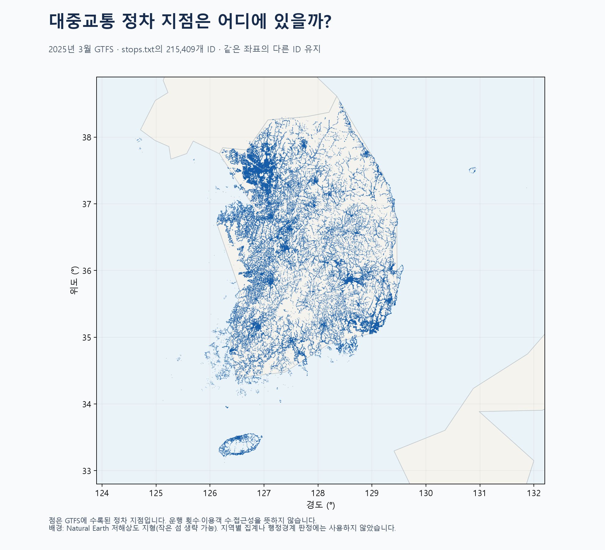

# 2025년 3월 GTFS 정차 지점 분포

`stops_map.html`을 브라우저에서 열면 확대·이동·정류장 이름/ID 검색이 가능합니다. 점 위에 마우스를 올리면 가까운 지점 하나의 이름·ID·좌표가 나타납니다. 같은 위치에 여러 ID가 있으면 하나만 표시될 수 있습니다. 파일 안에 데이터가 포함되어 있어 외부 지도 서버나 인터넷 연결이 필요하지 않습니다.

## 사용 데이터
- 원본: `대중교통GTFS(2025년 기준)/202503_GTFS_DataSet/stops.txt`.
- 열: `stop_id`(지점 식별자), `stop_name`(이름), `stop_lat`(위도), `stop_lon`(경도).
- 앞선 인구 분석의 2023년과 별개로, 보유 GTFS 중 가장 최근인 2025년 3월 자료를 사용했습니다. 현재 실시간 정류장 정보가 아닙니다.
- 이번 단계는 정차 지점 위치만 사용합니다. 노선·운행·승객과 연결하지 않았고 ID 접두사로 교통수단을 추정하지 않았습니다.

## 전처리 및 검증
1. `stops.txt`를 UTF-8 CSV로 읽었습니다. 줄 사이 빈 줄은 CSV 판독기의 기본 동작으로 건너뛰었습니다. ID는 문자열로 보존했습니다. `extracted` 사본은 중복 집계하지 않았습니다.
2. 215,409행을 확인했습니다. 필수 열의 결측, 빈 ID/이름, 중복 ID는 없습니다.
3. 위도·경도를 숫자로 변환하고 유한값과 전 세계 좌표 범위를 검사했습니다. 넓은 확인 범위(위도 32~40도, 경도 123~133도) 안에도 모두 들어갑니다. 이는 모든 좌표의 현장 정확성을 보증하지 않습니다.
4. 같은 위도·경도가 앞선 행과 중복되는 행은 4,282개입니다. 서로 다른 정차 지점 ID일 수 있어 삭제하지 않았습니다. 이름이 같아도 합치지 않았습니다. 제거하거나 채운 행은 없습니다.
5. PNG에는 원본 좌표를 사용했습니다. HTML은 파일 크기를 줄이도록 소수 7자리까지 좌표를 보존했습니다. 표본추출 없이 모든 지점을 넣었습니다.
6. 지도는 경도에 cos(36도)를 적용한 단순 좌표 표시입니다. 거리·면적을 측정하는 도구가 아닙니다. 확대와 이동으로 세부 분포를 확인할 수 있습니다.
7. 배경은 설치된 pyogrio에 포함된 Natural Earth 저해상도 지형입니다. 작은 섬이 생략될 수 있으며 정차 지점을 배경 경계로 자르지 않았습니다. 행정구역별 집계나 정밀한 위치 판정에는 사용하지 않았습니다.

## 읽는 방법
- 점이 빽빽한 곳은 수록 지점이 많이 겹치는 곳입니다. 전국 그림에서는 중첩과 투명도 때문에 정확한 개수를 눈으로 셀 수 없습니다.
- 지점 개수는 정류장 건물 수와 같지 않을 수 있습니다. 방향별 정류장이나 같은 좌표의 별도 ID를 그대로 유지했습니다.
- 운행 횟수, 운영 중 여부, 이용객, 배차 간격, 접근성은 이 지도만으로 판단할 수 없습니다. 이를 보려면 노선·운행시각 자료와 추가로 연결해야 합니다.
- 행정경계가 없어 이번 단계에서는 시도별 개수를 계산하지 않았습니다.

## 결과 파일
- `stops_map.html`: 오프라인 확대·이동·검색 지도.
- `stops_distribution.png`: 전체 분포 이미지.
- `stops_clean.csv`: 검증한 전체 정차 지점.
- `validation.json`: 원본 경로와 검증 수치.
- 재실행: `.venv/Scripts/python.exe visualizations/06_gtfs_stops_2025/make_map.py`.
