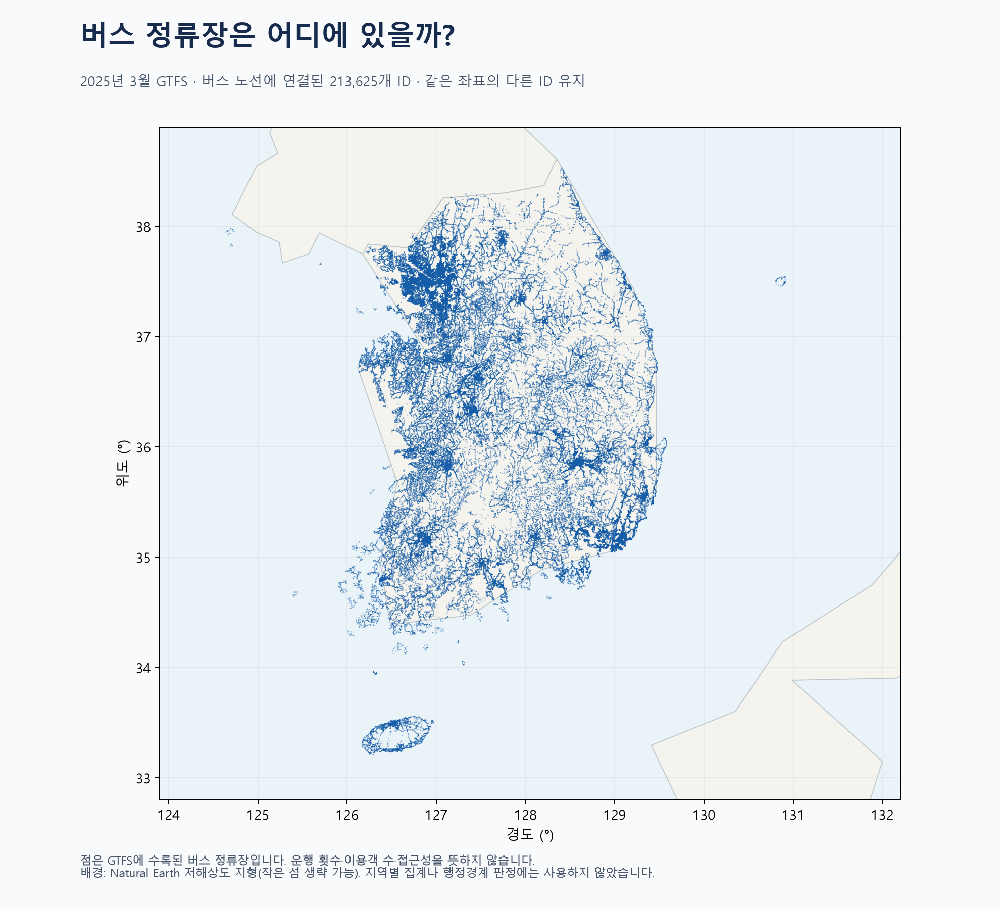

# 2025년 3월 버스 정류장만 표시한 지도

`stops_map.html`을 브라우저에서 열어 확대·이동·이름 또는 ID 검색을 할 수 있습니다. 데이터가 포함된 오프라인 지도입니다.

## 사용한 원본과 버스 정의
- 폴더: `대중교통GTFS(2025년 기준)/202503_GTFS_DataSet`.
- 사용 파일: `routes.txt`, `trips.txt`, `stop_times.txt`, `stops.txt`.
- 분류 근거: `대중교통GTFS(2025년 기준)/202503_GTFS_설명서.pdf` 4쪽의 KTDB 코드 정의와 10쪽의 규모표.
- 이 자료는 일반 GTFS와 route_type 코드가 다릅니다. **0=시내/농어촌/마을버스, 3=시외버스, 5=공항리무진버스**를 버스로 선택했습니다. 정류장 ID 접두사로 추정하지 않았습니다.
- 자료는 2025년 3월 평일 1일 기준입니다. 현재 실시간 운행 정보가 아닙니다.

## 전처리
1. 버스 노선 25,941개를 선택하고 trips와 연결해 운행 311,764개를 확인했습니다.
2. stop_times 18,889,140행을 50만 행씩 읽어 버스 운행의 stop_id를 수집했습니다. 노선·운행 ID 중복, 누락과 운행 참조 관계를 검사했습니다.
3. 수집한 정류장 ID의 합집합을 만들고 stops의 좌표·이름과 연결했습니다. 같은 정류장에 여러 버스 유형이 정차해도 1개 ID로 계산했습니다.
4. 전체 215,409개 중 버스 정류장 **213,625개**를 남기고 나머지 **1,784개**를 제외했습니다. 버스 총계 및 유형별 개수는 설명서 10쪽과 일치합니다.
5. 좌표 결측, 중복 ID, 잘못된 위도·경도 범위를 검사했습니다. 같은 좌표의 서로 다른 ID는 합치지 않았습니다. 상세 좌표 검증은 `validation.json`에 있습니다.

| 버스 유형 | 정류장 ID 수 |
|---|---:|
| 시내·농어촌·마을버스 | 211,585 |
| 시외버스 | 1,745 |
| 공항리무진버스 | 1,562 |

유형 간 공용 정류장이 있어 표의 개수를 단순 합산하면 버스 전체 개수보다 커집니다.

## 지도 해석
- 점은 버스 노선과 연결된 정류장 ID입니다. 시설·건물 개수, 운행 횟수, 승객 수를 뜻하지 않습니다.
- 배경은 Natural Earth 저해상도 지형입니다. 제주 등 작은 섬이 생략될 수 있으며, 점이 바다 위에 보이는 것만으로 좌표 오류라고 판단하면 안 됩니다. 배경으로 정류장을 제거하지 않았습니다.
- PNG는 원본 좌표, HTML은 소수 7자리 좌표를 사용합니다. 단순 경위도 기반 표시로 거리 측정용이 아닙니다.
- HTML 지도는 확대·이동·검색을 지원하며 겹친 점 위에서는 가까운 ID 하나가 표시됩니다. 브라우저 실제 조작 검증은 수행하지 않았습니다.

## 결과 파일
- `bus_stops.csv`: 버스 정류장 ID·이름·좌표.
- `bus_stop_types.csv`: 정류장별 버스 유형 포함 여부.
- `bus_selection.json`: 연결·추출 검증 결과.
- `stops_map.html`: 버스만 표시한 검색 지도.
- 재실행: `.venv/Scripts/python.exe visualizations/07_bus_stops_2025/make_bus_map.py`.
- 지도 생성은 앞서 만든 `visualizations/06_gtfs_stops_2025/make_map.py`의 그리기 처리를 재사용합니다.
