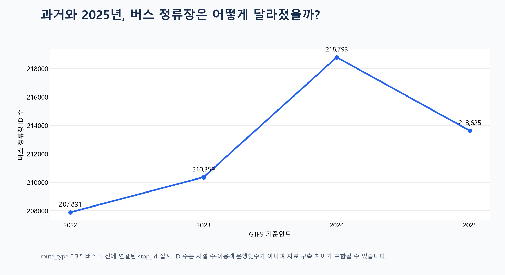

# 과거와 2025년 버스 정류장 비교

2021·2022·2023·2024·2025년 기준 GTFS 자료에서 같은 방식으로 버스 정류장을 집계했습니다.

| 기준연도 | 버스 정류장 ID | 버스 노선 | 버스 운행회차 |
|---|---:|---:|---:|
| 2022 | 207,891 | 26,606 | 333,800 |
| 2023 | 210,359 | 26,745 | 335,304 |
| 2024 | 218,793 | 29,449 | 358,878 |
| 2025 | 213,625 | 25,941 | 311,764 |

각 연도의 routes.txt에서 KTDB 버스 유형 0(시내·농어촌·마을), 3(시외), 5(공항리무진)을 고른 뒤 trips→stop_times로 연결된 stop_id를 추출하고 stops.txt에 존재하는 ID만 셌습니다. 2021년 대비 2025년 변화는 +2.76%입니다.

이 차이는 실제 정류장 신설·폐지뿐 아니라 GTFS ID 개편, 노선·운행 범위, 자료 구축 방식 차이가 포함될 수 있습니다. 원본은 수정하지 않았습니다.
