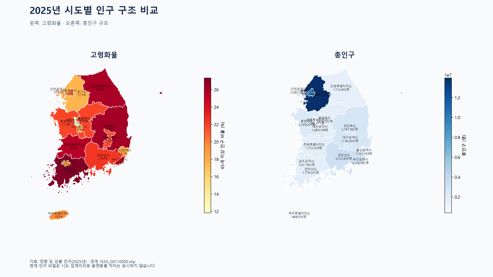

# 2025년 시도별 인구·고령화율 지도

`연령_및_성별_인구_–_읍면동_20260921123255.xlsx`의 `데이터` 시트에서 17개 시도의 총인구와 65세 이상 인구를 사용했습니다. 고령화율은 65세 이상 인구를 총인구로 나눈 값입니다. 읍면동 경계 도형을 시도 코드로 묶어 시도별 경계를 만들었습니다.

현재 파일은 실제 읍면동별 행이 아니라 시도 집계 자료이므로 지도도 시도 수준입니다.
