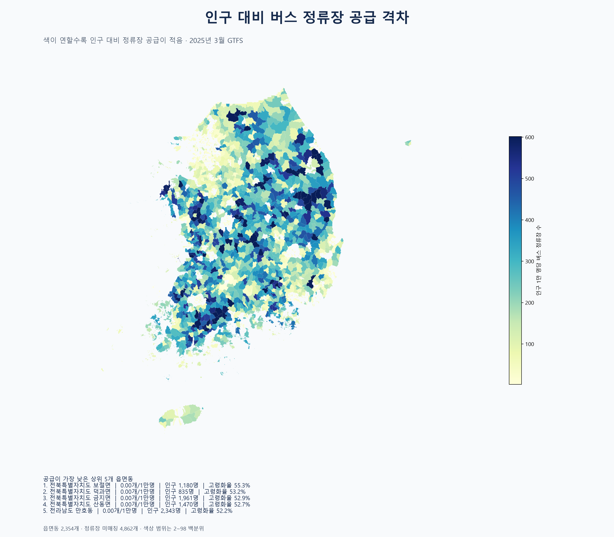

# 10번 시각화: 인구 대비 버스 정류장 공급

인구 1만 명당 정류장 수를 계산했습니다. `정류장수 ÷ 총인구 × 10,000`이며, 값이 낮을수록 인구 대비 정류장 공급이 적습니다. 정류장 좌표를 읍면동 폴리곤에 공간조인한 뒤 총인구와 결합했습니다.

이 지표만으로 서비스 품질이나 이용 가능성을 확정할 수는 없습니다. 정류장 위치는 표시하지만 배차 간격·노선 수·승하차 수요·보행거리·지형은 반영하지 않았습니다. 따라서 값이 낮은 지역은 DRT·마을버스 후보를 찾는 1차 선별 지표로 사용하고, 이후 노선·운행회차와 함께 검토해야 합니다.

## 전처리
- 2025년 3월 버스 route_type 0·3·5에 연결된 정류장 213,625개를 사용했습니다.
- 읍면동 경계와 좌표계를 맞춘 뒤 `within` 공간조인으로 정류장을 배정했습니다. 미매칭은 62,776개입니다.
- 인구 자료의 총인구와 결합했고, 정류장이 없는 읍면동도 0개로 유지했습니다.
- 색상만 2~98 백분위 범위로 조정했습니다.

## 해석
- 인구가 많은데 정류장 수가 적은 지역은 공급 부족 후보입니다.
- 인구는 적지만 정류장이 많은 지역은 생활권이 넓거나 마을버스 성격의 공급일 수 있어, 단순히 과잉 공급으로 판단하면 안 됩니다.
- 다음 단계에서는 고령화율, 인구 대비 정류장 수, 정류장별 노선·운행횟수를 결합해 이동격차 지수를 만들 수 있습니다.

하위 10개와 상위 10개 목록은 `stop_supply_by_dong.csv`에서 확인할 수 있습니다.

