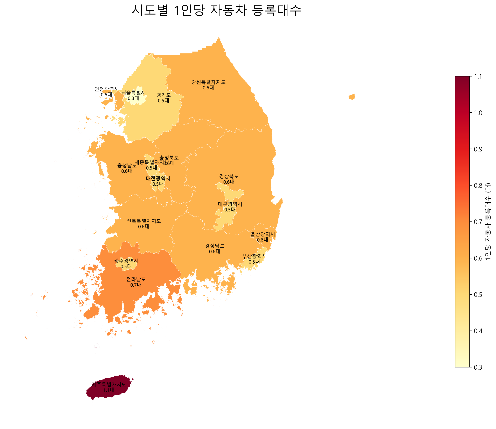

# 11번 시각화: 시도별 1인당 자동차 등록대수

## 사용 데이터

2025년 시도·시군구별 1인당 자동차 등록대수 CSV와 센서스 읍면동 경계 파일을 사용했다.

## 전처리 과정

1. CSV의 설명 행을 제거하고 행정구역명과 2025년 값을 추출했다.
2. 자동차 등록대수를 숫자형으로 변환하고 결측값을 제외했다.
3. 강원·전북 특별자치도 명칭을 현재 행정구역명으로 통일했다.
4. 센서스 경계의 시도 코드와 자동차 자료를 연결했다.
5. 읍면동 경계를 시도 단위로 합쳐 한 지역당 하나의 색으로 표시했다.

## 얻을 수 있는 인사이트

- 지역별 자동차 의존 수준을 인구 규모의 영향을 줄여 비교할 수 있다.
- 값이 높은 지역은 자동차 중심 이동이 강할 가능성이 있다.
- 대도시와 군 지역의 이동수단 환경 차이를 확인할 수 있다.

## 해석상 주의점

등록대수는 실제 운행량이나 주민별 차량 접근성을 의미하지 않는다. 법인·사업용 차량과 지역 특성이 값에 영향을 줄 수 있다.

