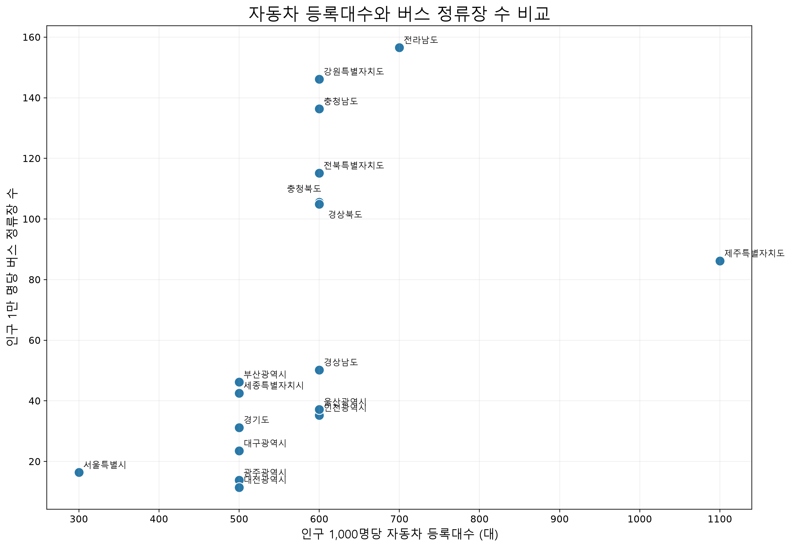

# 12번 시각화: 자동차 등록대수와 버스 정류장 수 비교

## 사용 지표

- 가로축: 인구 1,000명당 자동차 등록대수
- 세로축: 인구 1만 명당 버스 정류장 수
- 점 하나: 시도 하나

## 전처리 과정

1. 자동차 등록대수를 시도별 인구 1,000명 기준으로 환산했다.
2. 읍면동별 인구와 버스 정류장 수를 시도별로 합산했다.
3. `정류장 수 ÷ 인구 × 10,000`으로 인구 1만 명당 정류장 수를 계산했다.
4. 행정구역명을 통일한 뒤 두 자료를 시도 단위로 결합했다.
5. 두 지표를 산점도로 표현하고 지역명을 표시했다.

## 얻을 수 있는 인사이트

- 자동차 등록대수가 높고 정류장 공급이 낮은 지역은 자동차 의존도가 높을 수 있다.
- 자동차 등록대수가 낮고 정류장 공급이 높은 지역은 대중교통 중심 지역일 가능성이 있다.
- 두 지표가 모두 낮은 지역은 이동수단 선택지가 부족할 가능성이 있다.

## 해석상 주의점

정류장 개수는 운행 횟수, 노선 연결성, 정류장까지의 거리와 다르므로 실제 교통 서비스 수준 전체를 의미하지 않는다.
