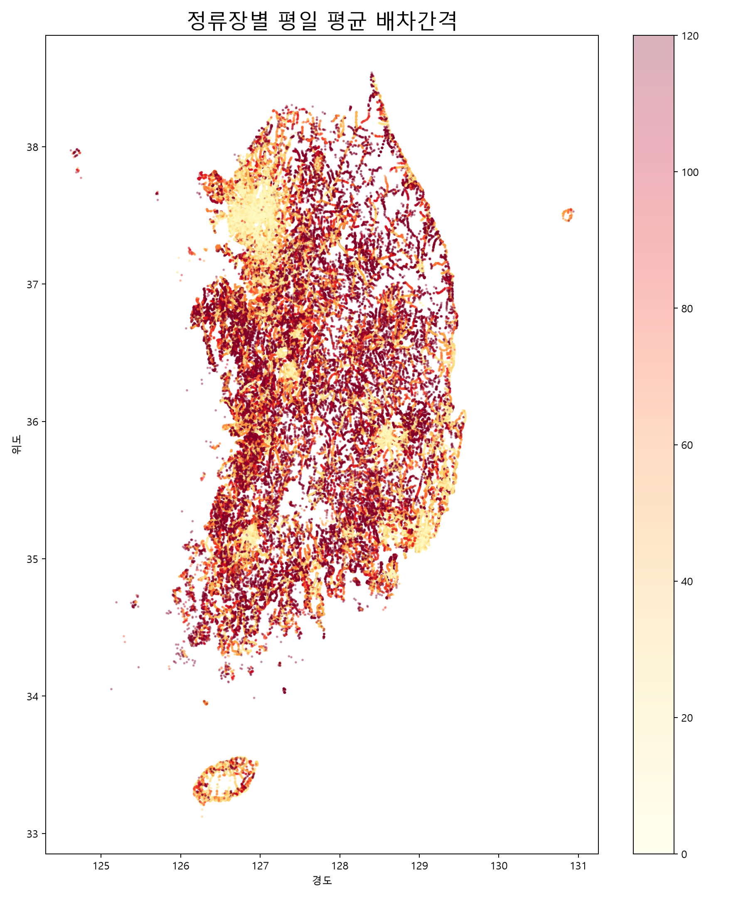

# 13번 시각화: 정류장별 평일 평균 배차간격



## 사용 데이터

- `대중교통GTFS(2025년 기준)/202503_GTFS_DataSet/stop_times.txt`
  - 운행별 정류장 도착·출발 시각
- `trips.txt`
  - 운행 ID와 노선 ID, 운행 서비스 ID 연결
- `calendar.txt`
  - 서비스가 운행되는 요일 정보
- `stops.txt`
  - 정류장 ID, 위도, 경도

## 전처리 과정

1. `stop_times.txt`에서 `trip_id`, `stop_id`, `departure_time`을 읽었다.
2. `trips.txt`와 결합해 각 운행의 노선 ID를 붙였다.
3. `calendar.txt`를 이용해 평일 운행 서비스만 선택했다.
4. 시간 문자열을 분 단위 숫자로 변환했다. 자정 이후 시간도 GTFS 형식에 맞춰 처리했다.
5. 같은 노선·정류장의 운행시각을 시간순으로 정렬했다.
6. 연속한 운행시각의 차이를 계산해 배차간격을 산출했다.
7. 0분, 음수, 240분 초과 값은 오류 가능성이 있어 제외했다.
8. `stops.txt`의 좌표를 결합해 전국 지도에 표시했다.

## 계산식

```text
배차간격 = 다음 운행시각 - 이전 운행시각
```

## 인사이트

색이 진할수록 배차간격이 길어 버스를 오래 기다려야 하는 정류장이다. 정류장 위치만 보는 기존 지도보다 실제 운행 공급의 차이를 확인할 수 있다.

## 주의점

GTFS 시간표 기반 결과라 실시간 운행 지연은 반영하지 않는다. 평균값이므로 출퇴근 시간과 비첨두 시간의 차이는 별도 분석이 필요하다.
