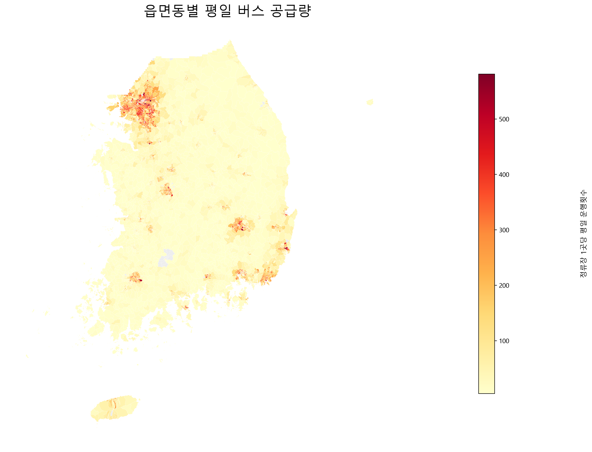

# 14번 시각화: 읍면동별 버스 공급량



## 사용 데이터

- 13번에서 계산한 GTFS 정류장별 운행 공급량
- `stops.txt`의 정류장 좌표
- `N3A_G0110000.shp` 센서스 읍면동 경계

## 전처리 과정

1. 정류장별 운행횟수와 좌표를 결합했다.
2. 위도·경도를 공간 객체로 변환하고 센서스 경계와 좌표계를 통일했다.
3. 각 정류장을 포함하는 읍면동에 공간 결합했다.
4. 읍면동별 정류장 수와 운행횟수를 합산했다.
5. 정류장 수가 많은 읍면동이 단순히 높게 보이지 않도록 정류장당 운행횟수를 계산했다.

## 계산식

```text
정류장당 평일 운행 공급량 = 읍면동 총 운행횟수 ÷ 읍면동 정류장 수
```

## 인사이트

같은 정류장 수라도 버스가 자주 운행되는 지역과 드물게 운행되는 지역을 구분할 수 있다. 인구·고령화 자료와 결합하면 공급이 부족한 읍면동을 찾을 수 있다.

## 주의점

정류장당 운행횟수는 노선의 실제 수송능력이나 좌석 수를 의미하지 않는다. 정류장 간 거리와 이용 수요도 함께 고려해야 한다.
