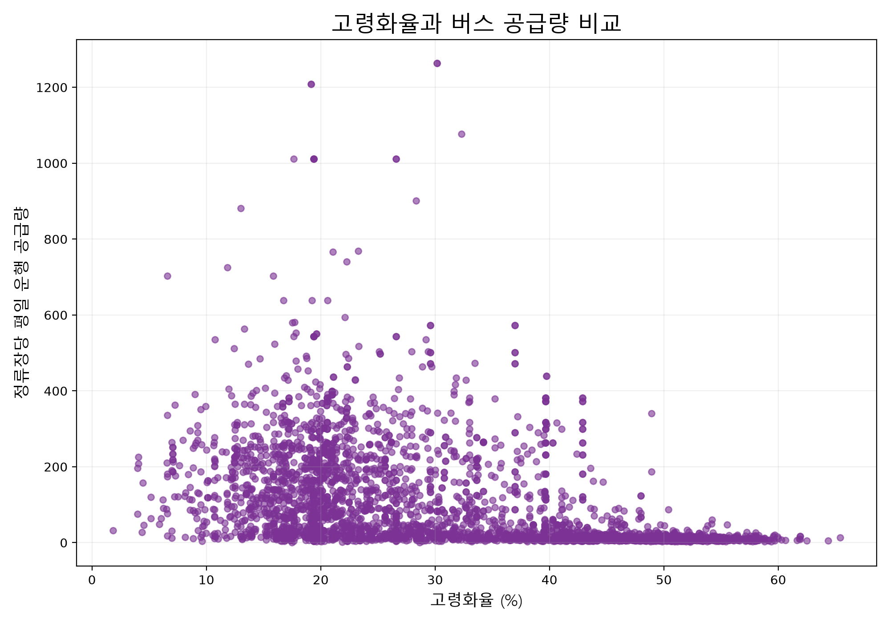

# 15번 시각화: 고령화율과 버스 공급량 비교

## 사용 데이터

- `14_dong_supply/dong_supply.csv`
  - 읍면동별 운행 공급량
- `visualizations/09_population_province_map/dong_age_population.csv`
  - 읍면동별 총인구, 65세 이상 인구, 고령화율

## 전처리 과정

1. 읍면동별 버스 공급량 자료를 준비했다.
2. 연령별 인구 자료에서 `고령화율`을 숫자형으로 변환했다.
3. 행정동 이름을 기준으로 두 자료를 결합했다.
4. 결합된 지역만 산점도에 사용했다.
5. 가로축에 고령화율, 세로축에 정류장당 평일 운행 공급량을 배치했다.

## 인사이트

고령화율이 높고 버스 공급량이 낮은 지역은 고령 주민의 이동 선택지가 부족할 가능성이 있다. 이런 지역은 DRT나 마을버스 검토 대상이 될 수 있다.

고령화율과 공급량의 관계가 뚜렷하지 않다면, 지역 규모·도로 구조·생활권 중심지 여부 같은 추가 변수를 함께 봐야 한다.

## 주의점

행정동명만으로 결합했기 때문에 동명이인이나 명칭 변경 지역은 별도 확인이 필요하다. 산점도는 관계를 보여줄 뿐 인과관계를 증명하지 않는다.
