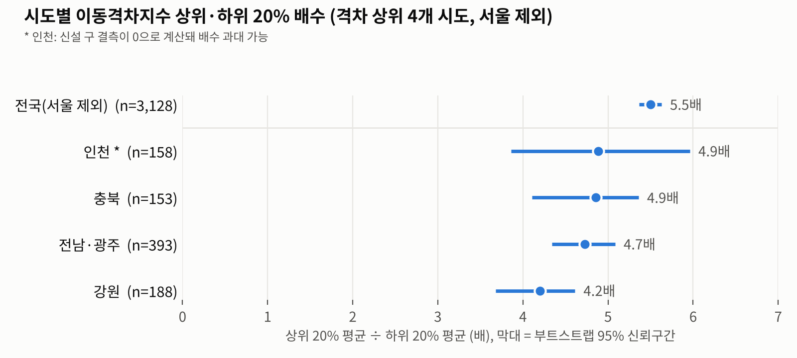

# 이동격차지수 상위·하위 배수 검증 (시도별, 20% 기준) — 최종

> 지수: 3차 이동격차지수(엔트로피 가중치) / 서울 제외 3,128개 읍면동, 15개 시도(전남·광주 통합)
> DRT: 신뢰도 상·중, 운영중·시범운영, 관광형 제외 / 난수 시드 20261011

## 방법

- 시도별로 읍면동을 지수 순으로 정렬해 상위 20%와 하위 20%를 같은 개수로 뽑고, **상위 평균 ÷ 하위 평균(배수)** 을 계산했습니다.
- **95% 신뢰구간:** 부트스트랩 5,000회
- **시도 간 차이:** 순열검정 3,000회 (시도별 log 배수의 표준편차)
- **지수 타당성:** 상·하위 20%의 실제 DRT 운행 비율을 Fisher 정확검정으로 비교했습니다.

## 결과 (보고서 표시: 전국 + 격차 상위 4개 시도)

| 시도 | 읍면동 | 배수 (95% CI) | DRT 상위 / 하위 | Fisher p |
|---|---|---|---|---|
| **전국(서울 제외)** | 3,128 | **5.5배** (5.4~5.6) | 51곳 / 18곳 (8.1% / 2.9%) | <0.001 |
| 인천* | 158 | 4.9배 (3.9~6.0) | 0 / 0 | - |
| 충북 | 153 | 4.9배 (4.1~5.4) | 3 / 0 | 0.238 |
| 전남·광주 | 393 | 4.7배 (4.3~5.1) | 0 / 0 | - |
| 강원 | 188 | 4.2배 (3.7~4.6) | 4 / 0 | 0.115 |

- 15개 시도 전체 배수는 **2.4~4.9배**이고, 모든 시도의 신뢰구간 하한이 2를 넘습니다(최저: 부산 2.2).
- 시도 간 격차 크기의 차이는 유의합니다(순열검정 p<0.001).
- 15개 시도 전체 표는 엑셀 `시도별_20%_전체` 시트에 있습니다.



\* 인천: 신설 4개 구(서해·검단·영종·제물포)의 결측이 0으로 계산돼 하위 평균이 낮게 나왔고, 그래서 배수가 과대 추정됐을 수 있습니다.

## 보고서 문장 (② 검증)

> 서울을 제외한 15개 시도별로 읍면동을 지수 순으로 정렬해 상위 20%와 하위 20%의 평균 지수 배수를 산출하고, 부트스트랩(5,000회) 95% 신뢰구간으로 안정성을 확인하였다. 전국 기준 상위 20%의 지수는 하위 20%의 5.5배(95% CI 5.4~5.6)였다. 격차는 인천*(4.9배)·충북(4.9배)·전남·광주(4.7배)·강원(4.2배) 순으로 컸고, 15개 시도 모두 신뢰구간 하한이 2를 넘었으며, 시도 간 차이도 유의하였다(순열검정 p<0.001). 실제 DRT 운행 비율도 상위 20%가 8.1%로 하위 20%(2.9%)보다 유의하게 높아(Fisher p<0.001), 지수가 실제 교통취약 지역을 포착함을 확인하였다.

## 정책제안 연결 (10분위 그림)

- DRT 운행 비율은 6분위(13.1%)에서 가장 높고, 가장 취약한 10분위에서는 6.7%로 떨어집니다.
- 전국 상위 20% 읍면동의 **92%(575/626곳)에 DRT가 없습니다.**
- 그림: `지수10분위별_DRT비율.png`

## 폴더 구성

| 파일 | 내용 |
|---|---|
| 상하위배수_시도별20%_상위5.png | 보고서 삽입 그림 (전국 + 상위 4개 시도) |
| 지수10분위별_DRT비율.png | 정책제안용 10분위 DRT 비율 그림 |
| 이동격차지수_상하위배수_검증_시도별20%.xlsx | 상위5 표, 15개 시도 전체, 시도 간 차이 검정, 10분위 |
| 이동격차지수_상하위배수_검증_시도별20%_결과정리.md | 이 문서 |
| 코드/validation_sido_20pct.py | 위 결과 전체(수치·그림·엑셀)를 재현하는 코드 |
| 코드/data/ | 코드 입력 데이터 (3차 지수 결과, DRT 운행 현황) |

## 코드 실행

```
pip install pandas numpy scipy matplotlib openpyxl
cd 코드
python validation_sido_20pct.py
```

- 입력: `data/eupmyeon_master_3차.csv`(Traffic_entropy_final.ipynb의 3차 지수 결과), `data/DRT_버스형_읍면동_상중.xlsx`
- 출력: `output/`에 그림 2장과 엑셀이 생성됩니다. 난수 시드가 20261011로 고정돼 있어 다시 돌려도 같은 값이 나옵니다(약 10초).
